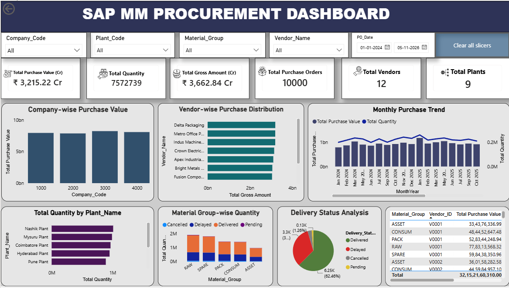

# 📊 SAP MM Procurement Analytics Dashboard – SAP HANA & Power BI

## 📌 Project Overview

This project focuses on analyzing SAP MM (Materials Management) procurement data using **SAP HANA and Microsoft Power BI** to generate meaningful business insights into procurement spending, vendor performance, purchase orders, material quantities, plant-wise expenditure, and purchasing trends.

The project involves retrieving procurement data from SAP HANA using SQL queries and connecting it to Power BI to develop an interactive procurement analytics dashboard.

The dashboard helps monitor procurement activities, analyze spending patterns, evaluate vendor contributions, and support data-driven business decisions.

**Note:** The dataset used for this portfolio project is synthetically generated for learning and analysis purposes. It is not an actual SAP system export.

---

## 🎯 Objectives

- Analyze overall procurement spending and purchasing activities.
- Identify vendors contributing the highest procurement expenditure.
- Compare procurement spending across different company codes.
- Analyze plant-wise procurement performance.
- Monitor monthly procurement spending trends.
- Understand material-wise purchasing quantities.
- Analyze gross amount, discount amount, tax amount, and net amount.
- Monitor purchase order status and delivery quantities.
- Track key performance indicators (KPIs) through interactive dashboards.
- Provide meaningful insights to support procurement decision-making.

---

## 🏗️ Data Source & Data Processing

This project follows an end-to-end procurement data analysis workflow using SAP HANA and Power BI.

### ⭐ Data Extraction – SAP HANA

- Accessed procurement data using SAP HANA.
- Created SQL queries to retrieve relevant procurement information.
- Extracted purchase order, vendor, material, plant, and company code details.
- Prepared the required data for Power BI analysis.

### 📚 Data Components

- **Purchase Order Data** – Contains PO number, PO item, document date, quantities, pricing, gross amount, discount, tax, and net amount.
- **Vendor Master** – Contains vendor codes and vendor names.
- **Material Master** – Contains material codes, descriptions, and material groups.
- **Plant Master** – Contains plant codes, plant names, and company codes.
- **Company Master** – Contains company codes and company names.

### 🔄 Data Integration – Power BI

- Connected SAP HANA procurement data to Power BI.
- Imported the required data for analysis.
- Established relationships between procurement and master data tables.
- Created DAX measures for KPI calculations.
- Developed interactive visualizations and slicers.

---

## 📈 Dashboard Features

The Power BI dashboard includes:

### ⭐ KPI Cards

- Total Procurement Spend
- Total Net Amount
- Total Gross Amount
- Total Order Quantity
- Total Vendors
- Total Purchase Orders

### 📊 Data Visualizations

- Vendor-wise Procurement Spend Analysis
- Company Code-wise Spend Analysis
- Plant-wise Procurement Analysis
- Monthly Procurement Spend Trend
- Material Group-wise Quantity Analysis
- Purchase Order Status Analysis
- Gross Amount vs Net Amount Comparison
- Vendor-wise Quantity Analysis

### 🎛️ Interactive Features

- Company Code Slicer
- Plant Code Slicer
- Vendor Name Slicer
- Material Group Slicer
- Purchase Order Date Slicer
- Purchase Order Status Slicer

---

## 🛠️ Tools & Technologies

- **SAP MM (Materials Management)**
- **SAP HANA**
- **SAP HANA SQL**
- **Microsoft Power BI**
- **Power Query**
- **DAX (Data Analysis Expressions)**
- **Microsoft Excel**
- **Data Modeling**
- **Data Visualization**

---

## 📸 Dashboard Preview

---

## 🔍 Key Business Insights

The dashboard helps identify:

- Which vendors contribute the highest procurement spending.
- Which company codes have the highest procurement expenditure.
- How procurement spending varies across different plants.
- Monthly procurement spending patterns and trends.
- Which material groups have the highest purchase quantities.
- The relationship between gross amount, discounts, taxes, and net amount.
- The distribution of purchase orders across different statuses.
- Opportunities to improve procurement spending visibility and purchasing decisions.

---

## 🚀 Conclusion

This project demonstrates how **SAP HANA, SQL, Power BI, Power Query, and DAX** can be combined to transform procurement data into meaningful business insights.

By connecting SAP HANA data with Power BI, the project provides an interactive dashboard for analyzing procurement expenditure, vendor performance, purchasing quantities, and purchase order activities.

The dashboard supports better procurement monitoring, spending analysis, and data-driven business decisions.

---

## 👩‍💻 Author

**Gayathri R**

Aspiring Data Analyst

**Technical Skills:** Excel | SQL | SAP HANA | SAP MM | Power BI | DAX | Python
